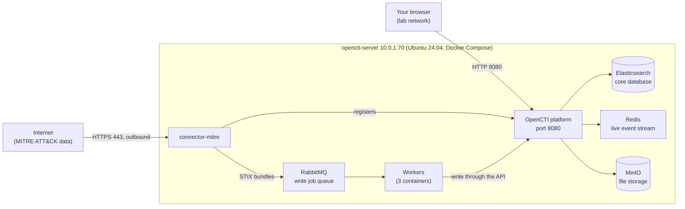

# Lab 16: OpenCTI Threat Intelligence Platform with Docker Compose

This lab installs Docker on a new VM, `opencti-server`, and runs OpenCTI with Docker Compose. OpenCTI is a Cyber Threat Intelligence (CTI) platform: it stores threats as linked objects, such as which malware a file hash belongs to, which attacker group uses it, and which techniques come with it. After the platform starts, the MITRE ATT&CK dataset is imported as a starting point.

## What this lab covers

- [Part A: Install Docker](#part-a-install-docker): Docker Engine and the Docker Compose plugin from Docker's official repository
- [Part B: Install OpenCTI with Docker Compose](#part-b-install-opencti-with-docker-compose): Elasticsearch (core database), Redis (live event stream), RabbitMQ (message queue for write jobs), MinIO (file storage), the OpenCTI platform and its worker processes
- [Part C: Import MITRE ATT&CK](#part-c-import-mitre-attck): the MITRE ATT&CK connector, which loads the baseline dataset

## Architecture



Data flow: the MITRE connector downloads ATT&CK data and puts it on the RabbitMQ queue as STIX bundles. STIX is the standard file format for threat intelligence. The workers take jobs from the queue and write them through the platform, which stores them in Elasticsearch. You browse to the platform on port 8080. Elasticsearch, Redis, RabbitMQ and MinIO talk to the platform over Docker's internal network.

## What you need

### Existing labs used

None. This lab is standalone.

### VM table

| VM name | Role | Private IP | OS | CPU | RAM | Disk |
|---|---|---|---|---|---|---|
| opencti-server | OpenCTI stack in Docker Compose | 10.0.1.70 | Ubuntu 24.04 | 8 vCPU | 16 GB | 50 GB (assumption) |

- Elasticsearch and the platform need real memory, so OpenCTI runs on its own VM and not on a VM that already runs other services.
- Disk is an assumption. Below 40 GB free, keep to the MITRE data only.

### Placeholder table

| Placeholder | Example value | Where to find or set it |
|---|---|---|
| `<VM_USER>` | ubuntu | The Linux user you log in to `opencti-server` with |
| `<OPENCTI_PRIVATE_IP>` | 10.0.1.70 | On `opencti-server`: `hostname -I` (first address) |
| `<ADMIN_EMAIL>` | admin@soc.lab | Your choice. This is the OpenCTI login name |
| `<ADMIN_PASSWORD>` | (12+ characters) | Your choice. A very short password stops the login working (assumption: 12+ characters; the exact minimum is not documented) |

Every other secret (admin API token, MinIO, RabbitMQ, encryption key) is generated by the script in step B4.

### Where secrets live

- All secrets are in `/root/opencti/docker/.env` on `opencti-server`, readable by root only (`chmod 600`).
- Save `<ADMIN_PASSWORD>` and the `OPENCTI_ADMIN_TOKEN` value in your password manager. The admin token is the master API key; connectors and later integrations use it.
- Never change `OPENCTI_ENCRYPTION_KEY` after the first start. Data that was encrypted with it can no longer be read.
- Never upload `.env` to GitHub. This lab's `.gitignore` blocks it.

## Part A: Install Docker

Docker runs each program in its own container. A container is a running copy of an image (a packaged application). Docker Compose starts many containers from one file, `docker-compose.yml`.

**Run on: opencti-server.** All commands in this lab run as root. Start with:

```bash
sudo -i
```

### A1. Update the system

```bash
apt update && apt upgrade -y
```

What it does: installs the latest Ubuntu updates. If it says a reboot is needed, run `reboot`, log in again and run `sudo -i`.

### A2. Remove old Docker packages

```bash
apt remove -y docker docker-engine docker.io containerd runc 2>/dev/null
```

What it does: removes any old Docker that came with the image. Errors here are fine; they mean there was nothing to remove.

### A3. Add Docker's repository

```bash
apt update
apt install -y ca-certificates curl gnupg
install -m 0755 -d /etc/apt/keyrings
curl -fsSL https://download.docker.com/linux/ubuntu/gpg -o /etc/apt/keyrings/docker.asc
chmod a+r /etc/apt/keyrings/docker.asc
echo "deb [arch=$(dpkg --print-architecture) signed-by=/etc/apt/keyrings/docker.asc] https://download.docker.com/linux/ubuntu $(. /etc/os-release && echo $VERSION_CODENAME) stable" \
  | tee /etc/apt/sources.list.d/docker.list > /dev/null
```

What it does: downloads Docker's signing key and adds Docker's package repository, so `apt` installs the current Docker and can check the packages are genuine.

### A4. Install Docker

```bash
apt update
apt install -y docker-ce docker-ce-cli containerd.io docker-buildx-plugin docker-compose-plugin
```

What it does: installs the Docker engine and the `docker compose` command.

**Check:**

```bash
docker run --rm hello-world
```

Expected output (first lines, similar to):

```
Hello from Docker!
This message shows that your installation appears to be working correctly.
```

## Part B: Install OpenCTI with Docker Compose

**Run on: opencti-server (as root)**

### B1. Raise the memory map limit

```bash
sysctl -w vm.max_map_count=1048575
echo "vm.max_map_count=1048575" | tee -a /etc/sysctl.conf
```

What it does: Elasticsearch opens many memory-mapped files and will not start with Ubuntu's default limit. The first line applies the new limit now; the second keeps it after reboot.

**Check:**

```bash
sysctl vm.max_map_count
```

Expected output:

```
vm.max_map_count = 1048575
```

### B2. Add 4 GB of swap

```bash
fallocate -l 4G /swapfile
chmod 600 /swapfile
mkswap /swapfile
swapon /swapfile
echo '/swapfile none swap sw 0 0' | tee -a /etc/fstab
```

What it does: creates a 4 GB swap file (disk space used as spare memory) and turns it on at every boot. The first data import uses a lot of memory; swap stops Linux from killing a container during that spike.

**Check:**

```bash
free -h
```

Expected output (similar to): a `Swap:` line with `4.0Gi` total.

### B3. Download the OpenCTI Compose files

```bash
mkdir -p ~/opencti && cd ~/opencti
git clone https://github.com/OpenCTI-Platform/docker.git
cd docker
```

What it does: downloads OpenCTI's official Docker repository to `/root/opencti/docker`. It holds `docker-compose.yml` (the list of containers and how they connect) and `.env.sample` (sample settings). The images download later, at the first start.

**Check:**

```bash
ls /root/opencti/docker
```

Expected output (similar to): a list that includes `docker-compose.yml` and `.env.sample`.

### B4. Create the `.env` settings file

Edit the three `# CHANGE THIS` values, then paste the whole block. This script is also in [configs/generate-env.sh](configs/generate-env.sh).

- `OPENCTI_IP` must be the address you type in the browser. If it is `localhost` while you browse to the IP, login loops back to the login page.
- `ADMIN_PASSWORD` must be long (12 or more characters). A very short password stops the login working.
- Keep the single quotes around the values.

```bash
cd /root/opencti/docker

# CHANGE THIS: the three values below
OPENCTI_IP='10.0.1.70'
ADMIN_EMAIL='<ADMIN_EMAIL>'
ADMIN_PASSWORD='<ADMIN_PASSWORD>'

cat > .env << EOF
OPENCTI_HOST=${OPENCTI_IP}
OPENCTI_PORT=8080
OPENCTI_EXTERNAL_SCHEME=http
OPENCTI_ADMIN_EMAIL=${ADMIN_EMAIL}
OPENCTI_ADMIN_PASSWORD=${ADMIN_PASSWORD}
OPENCTI_ADMIN_TOKEN=$(cat /proc/sys/kernel/random/uuid)
OPENCTI_HEALTHCHECK_ACCESS_KEY=$(cat /proc/sys/kernel/random/uuid)
OPENCTI_ENCRYPTION_KEY=$(openssl rand -base64 32)
PLATFORM_REGISTRATION_TOKEN=$(openssl rand -hex 32)

MINIO_ROOT_USER=$(cat /proc/sys/kernel/random/uuid)
MINIO_ROOT_PASSWORD=$(cat /proc/sys/kernel/random/uuid)
RABBITMQ_DEFAULT_USER=opencti
RABBITMQ_DEFAULT_PASS=$(openssl rand -base64 32)
OPENSEARCH_ADMIN_PASSWORD=$(openssl rand -hex 16)
SMTP_HOSTNAME=localhost
ELASTIC_MEMORY_SIZE=4G

XTM_COMPOSER_ID=$(cat /proc/sys/kernel/random/uuid)
COMPOSE_PROJECT_NAME=opencti

CONNECTOR_EXPORT_FILE_STIX_ID=$(cat /proc/sys/kernel/random/uuid)
CONNECTOR_EXPORT_FILE_CSV_ID=$(cat /proc/sys/kernel/random/uuid)
CONNECTOR_EXPORT_FILE_TXT_ID=$(cat /proc/sys/kernel/random/uuid)
CONNECTOR_IMPORT_FILE_STIX_ID=$(cat /proc/sys/kernel/random/uuid)
CONNECTOR_IMPORT_DOCUMENT_ID=$(cat /proc/sys/kernel/random/uuid)
CONNECTOR_IMPORT_FILE_YARA_ID=$(cat /proc/sys/kernel/random/uuid)
CONNECTOR_IMPORT_EXTERNAL_REFERENCE_ID=$(cat /proc/sys/kernel/random/uuid)
CONNECTOR_ANALYSIS_ID=$(cat /proc/sys/kernel/random/uuid)
CONNECTOR_OPENCTI_ID=$(cat /proc/sys/kernel/random/uuid)
CONNECTOR_MITRE_ID=$(cat /proc/sys/kernel/random/uuid)

# XTM One is not used in this lab. These values only stop "variable is not set" warnings.
XTM_ONE_EXTERNAL_SCHEME=http
XTM_ONE_HOST=localhost
XTM_ONE_PORT=4000
XTM_ONE_ADMIN_EMAIL=notused@example.com
XTM_ONE_ADMIN_PASSWORD=notused
XTM_ONE_SECRET_KEY=notused
XTM_ONE_POSTGRES_USER=notused
XTM_ONE_POSTGRES_PASSWORD=notused
EOF
chmod 600 .env
```

What it does: writes `.env` with your address and login, and random values for every token, password and ID. A UUID is a random 36-character ID; several settings must be in that format. `ELASTIC_MEMORY_SIZE=4G` gives Elasticsearch 4 GB, which fits a 16 GB VM. Then it makes the file readable by root only.

First make sure no placeholder is left. This must print nothing:

```bash
grep -n '<' .env
```

**Check:** compare your `.env` with the official sample.

```bash
diff <(grep -oE '^[A-Z0-9_]+' .env.sample | sort -u) <(grep -oE '^[A-Z0-9_]+' .env | sort -u)
```

Expected output (similar to): only `XTM_ONE_...` lines on the `<` side, such as `< XTM_ONE_ENTERPRISE_LICENSE`. Any other name on the `<` side is a setting your OpenCTI version added: copy that line from `.env.sample` into `.env`.

### B5. Turn off XTM One

XTM One is a separate, licensed Filigran product. The OpenCTI Compose file includes it, with its own PostgreSQL database. This lab does not use it. If it starts, its database fails with "unhealthy", and the platform logs `getaddrinfo EAI_AGAIN xtm-one` every 5 minutes. This step comments out its services and the platform setting that points to it. The script is also in [configs/disable-xtm-one.sh](configs/disable-xtm-one.sh).

```bash
cd /root/opencti/docker
cp docker-compose.yml docker-compose.yml.bak
python3 - << 'PY'
import re
p = 'docker-compose.yml'
targets = {'pgsql-xtm-one', 'xtm-one', 'xtm-one-worker', 'xtm-composer', 'rsa-key-generator'}
out, in_block = [], False
for line in open(p).read().split('\n'):
    m = re.match(r'^  ([a-zA-Z0-9_.-]+):\s*$', line)
    if m:
        in_block = m.group(1) in targets
    elif in_block and line.strip() and not line.startswith('   ') and not line.lstrip().startswith('#'):
        in_block = False
    out.append('#' + line if in_block else line)
open(p, 'w').write('\n'.join(out))
print("done")
PY
sed -i 's|^\( *\)- XTM__XTM_ONE_URL=|\1#- XTM__XTM_ONE_URL=|' docker-compose.yml
```

What it does: saves a backup as `docker-compose.yml.bak`, puts `#` in front of every line of the five XTM services (`pgsql-xtm-one`, `xtm-one`, `xtm-one-worker`, `xtm-composer`, `rsa-key-generator`), and comments out the `XTM__XTM_ONE_URL` line in the `opencti` service. To undo: `cp docker-compose.yml.bak docker-compose.yml`.

**Check:**

```bash
docker compose config --services | grep -c xtm
```

Expected output:

```
0
```

If `docker compose config` prints an error instead, restore the backup and paste the error into a chat.

### B6. Give the platform 10 minutes to start

The first start takes about 7 minutes while OpenCTI builds its database. The Compose healthcheck gives up after about 200 seconds (`interval: 10s` × `retries: 20`), marks the platform "unhealthy", and the workers refuse to start. `start_period` gives it 10 minutes before failures count.

```bash
cd /root/opencti/docker
LINE=$(awk '/^  opencti:/{f=1; next} f && /^  [a-zA-Z0-9_.-]+:/{exit} f && /^    healthcheck:/{print NR; exit}' docker-compose.yml)
echo "$LINE"
sed -i "${LINE}a\\      start_period: 600s" docker-compose.yml
```

What it does: finds the `healthcheck:` line inside the `opencti` service and adds `start_period: 600s` under it. If `echo` prints nothing, the `opencti` service has no healthcheck; skip the `sed` line.

**Check:**

```bash
sed -n "${LINE},$((LINE+5))p" docker-compose.yml
```

Expected output (similar to):

```
    healthcheck:
      start_period: 600s
      test:  ["CMD", "wget", "-qO-", "http://opencti:8080/health?health_access_key=${OPENCTI_HEALTHCHECK_ACCESS_KEY}"]
      interval: 10s
      timeout: 5s
      retries: 20
```

Then check the whole file still reads correctly:

```bash
docker compose config > /dev/null && echo OK
```

Expected output: `OK`

### B7. Start OpenCTI

```bash
cd /root/opencti/docker
docker compose up -d
```

What it does: downloads about 8 GB of images, then starts every container in order in the background (`-d`). The first start takes 10 to 20 minutes in total.

Follow the platform log (press `Ctrl+C` to stop watching; the containers keep running):

```bash
docker compose logs -f opencti
```

Several minutes with only `info` lines is normal. Do not restart anything while it initializes.

**Check:**

```bash
docker compose logs opencti | grep -E "API ready|Platform started"
```

Expected output (similar to):

```
[OPENCTI] API ready on port 8080
[OPENCTI] Platform started 422574 ms
```

Then:

```bash
docker compose up -d
docker compose ps
```

What it does: starts any worker or connector that stopped while the platform was still starting. `ps` should show every container as `Up`, and `opencti-opencti-1` as `(healthy)`.

Two log messages are harmless and can be ignored: `SMTP seems down` (no mail server in this lab) and XTM registration messages.

## Part C: Import MITRE ATT&CK

MITRE ATT&CK is a public catalogue of attacker techniques, attacker groups (called intrusion sets in OpenCTI) and malware, already linked to each other. The official Compose file includes the MITRE connector (`connector-mitre`), and step B4 gave it its ID (`CONNECTOR_MITRE_ID`), so it starts with the stack in Part B and imports on its own. No API key is needed.

**Run on: opencti-server (as root)**

### C1. Confirm the MITRE connector is running

```bash
cd /root/opencti/docker
docker compose ps connector-mitre
```

What it does: shows the state of the MITRE connector container.

**Check:** expected output (similar to):

```
NAME                        ...   STATUS
opencti-connector-mitre-1   ...   Up 10 minutes
```

### C2. Watch the import

```bash
docker compose logs -f connector-mitre
```

What it does: follows the connector's log while it downloads ATT&CK and sends it to the queue. Press `Ctrl+C` to stop watching. The import takes about 20 to 40 minutes after the connector starts.

**Check:** the log shows no `ERROR` lines (similar to). If the import does not appear in the web interface after 40 minutes, check the workers:

```bash
docker compose logs --tail 30 worker
```

## Test

Use a browser on a PC on the lab network. Open it in a private (incognito) window the first time, so an old cookie cannot cause a login loop.

### T1. Docker

**Run on: opencti-server (as root)**

```bash
docker run --rm hello-world
```

Expected: `Hello from Docker!`

### T2. OpenCTI login

1. Open `http://10.0.1.70:8080` (`http://<OPENCTI_PRIVATE_IP>:8080`).
2. Enter `<ADMIN_EMAIL>` and `<ADMIN_PASSWORD>`, then click **Sign in**.

Expected: the OpenCTI dashboard opens.

### T3. MITRE ATT&CK data

1. Left menu **Data** → **Ingestion** → **Connectors** (in some versions: **Data** → **Connectors**). Expected: the **MITRE ATT&CK** connector is listed with a recent run.
2. Left menu **Threats** → **Intrusion sets**. Expected: a list of attacker groups, for example **APT28** (similar to).
3. Left menu **Arsenal** → **Malware**. Expected: a list of malware families.
4. Click one intrusion set, then its **Knowledge** tab. Expected: the malware and ATT&CK techniques linked to that group.

## Common problems

| Problem | Fix |
|---|---|
| Login returns to the login page with no error | `OPENCTI_HOST` does not match the address in the browser. Run `sed -i 's#^OPENCTI_HOST=.*#OPENCTI_HOST=10.0.1.70#' .env` (your IP), then `docker compose up -d --force-recreate opencti`. Wait for `API ready on port 8080` and log in from a private window |
| Login still fails with the right email and password | The admin password is too short. Set a longer one in `.env` (`OPENCTI_ADMIN_PASSWORD=`), run `docker compose up -d --force-recreate opencti`, and log in from a private window |
| First start: `opencti` shows `unhealthy` and the workers do not start | Do step [B6](#b6-give-the-platform-10-minutes-to-start). Wait for `Platform started` in `docker compose logs opencti`, then run `docker compose up -d` |
| `pgsql-xtm-one is unhealthy`, or `getaddrinfo EAI_AGAIN xtm-one` every 5 minutes | XTM One is still turned on. Do step [B5](#b5-turn-off-xtm-one), then `docker compose up -d --remove-orphans` |
| Elasticsearch keeps restarting | Check `sysctl vm.max_map_count`; it must be `1048575`. Do step [B1](#b1-raise-the-memory-map-limit) and run `docker compose up -d` |

Warning: `docker compose down` stops the stack and keeps your data. `docker compose down -v` also deletes all OpenCTI data, with no prompt.

## Next steps

- Connect OpenCTI to intelligence of your own, such as your MISP events, with connectors: [OpenCTI connectors](https://docs.opencti.io/latest/deployment/connectors/)
- Explore the relationships between malware, intrusion sets and ATT&CK techniques: [OpenCTI documentation](https://docs.opencti.io/latest/)
- Official installation reference for the Docker deployment: [OpenCTI installation](https://docs.opencti.io/latest/deployment/installation/)
