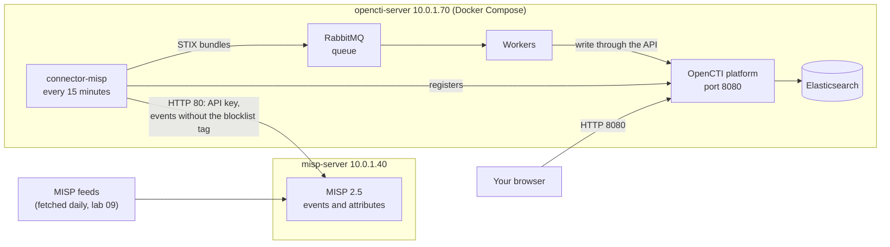

# Lab 17: Connect MISP to OpenCTI

This lab adds the official MISP connector to OpenCTI. Every 15 minutes the connector reads events from your MISP and turns them into STIX objects in OpenCTI: each event becomes a report, and each attribute becomes an indicator and an observable. Large blocklist feeds with no attribution are filtered out, so the import keeps the events that name malware families, actors and sources. OpenCTI then links them to the MITRE ATT&CK data from lab 16.

## What this lab covers

- [Part A: Create a MISP API key for OpenCTI](#part-a-create-a-misp-api-key-for-opencti): a dedicated key for the connector, limited to the lab network
- [Part B: Connect MISP to OpenCTI](#part-b-connect-misp-to-opencti): the `connector-misp` container, with the blocklist filter

## Architecture



Data flow: the connector asks MISP's API for events that do not carry the tag `osint:source-type="block-or-filter-list"`. It converts them to STIX bundles and puts them on the RabbitMQ queue. The workers write them into OpenCTI.

## What you need

### Existing labs used

| Lab | What it gives this lab |
|---|---|
| [08-misp-lab](../08-misp-lab/) | MISP 2.5 on `misp-server` (10.0.1.40) |
| [09-wazuh-misp-lab](../09-wazuh-misp-lab/) | Part A: feeds fetched as real MISP events every day. Part B: MISP answering on `http://10.0.1.40` |
| [16-opencti-lab](../16-opencti-lab/) | OpenCTI on `opencti-server` (10.0.1.70) with MITRE ATT&CK, files in `/root/opencti/docker` |

The connector reads MISP **events**. Feeds that were only cached, and never fetched, create no events, so nothing would import. Lab 09 Part A fetches them.

### VM table

No new VM.

| VM name | Role | Private IP | CPU | RAM | Disk |
|---|---|---|---|---|---|
| misp-server | MISP (source) | 10.0.1.40 | 2 vCPU | 8 GB | 50 GB |
| opencti-server | OpenCTI and `connector-misp` | 10.0.1.70 | 8 vCPU | 16 GB | 50 GB (assumption) |

### Placeholder table

| Placeholder | Example value | Where to find or set it |
|---|---|---|
| `<MISP_IP>` | 10.0.1.40 | On `misp-server`: `hostname -I` (first address) |
| `<MISP_URL>` | http://10.0.1.40 | The address MISP uses for itself (`MISP.baseurl`). It is `http://` after lab 09 Part B, otherwise `https://` |
| `<MISP_OPENCTI_KEY>` | (40 characters) | Created in step A1. MISP shows it only once |
| `<LAB_NETWORK>` | 10.0.1.0/24 | The private network of the lab VMs |

### Where secrets live

- The MISP key is stored only in `/root/opencti/docker/.env` on `opencti-server` (root only, `chmod 600` from lab 16). The connector reads it from there.
- Also save it in your password manager.
- Never put it in `docker-compose.override.yml`, a screenshot or this repository. The `.gitignore` blocks `.env`.

## Part A: Create a MISP API key for OpenCTI

**Run on: misp-server (MISP web interface, logged in as admin)**

### A1. Create the key

1. Open `http://10.0.1.40` (`<MISP_URL>`) and log in.
2. **Administration** → **List Auth Keys** → **Add authentication key**.
3. Fill in:
   - **User**: `admin@admin.test`
   - **Comment**: `opencti`
   - **Allowed IPs**: `10.0.1.0/24` (`<LAB_NETWORK>`)
   - **Expiration**: leave empty
   - **Read only**: leave unticked. It removes the permissions the connector needs.
4. Click **Submit**. Copy the key at once; MISP shows it only once. Save it in your password manager as `<MISP_OPENCTI_KEY>`.

What it does: creates a separate API key used only by the connector. **Allowed IPs** makes MISP refuse this key from any address outside the lab network. If the key leaks, you delete this one key; the admin login and the Wazuh key from lab 09 keep working.

Assumption: Allowed IPs is the lab network, not only 10.0.1.70. With a single address, MISP refused the connector with 403 in the original setup (see [Common problems](#common-problems)).

**Check:** **Administration** → **List Auth Keys** shows a row with comment `opencti` and allowed IPs `10.0.1.0/24`. The key itself is tested from `opencti-server` in step B2.

### A2. Make sure attributed feeds are fetched

Lab 09 enabled feeds. The connector filter in Part B skips every event tagged `osint:source-type="block-or-filter-list"`. In MISP's default list that tag is on most IP, domain and URL blocklists, and also on the CSV feed **Malware Bazaar**. Hashes with malware family names come from the **MISP-format** feed **MalwareBazaar** (abuse.ch), which is not tagged.

1. **Sync Actions** → **Feeds**.
2. Find **MalwareBazaar** with format **MISP Feed**. If it is not enabled, tick it and click **Enable selected**.
3. Click **Fetch and store all feed data**.

What it does: makes MISP download the attributed MalwareBazaar events, so OpenCTI has hashes with malware family names to link. Assumption: the feed choice; your post does not name the feeds.

**Check:** **Administration** → **Jobs** shows the `fetch_feeds` job completing, and **Event Actions** → **List Events** shows MalwareBazaar events (similar to).

## Part B: Connect MISP to OpenCTI

**Run on: opencti-server, as root** (`sudo -i`). All commands run in `/root/opencti/docker`.

### B1. Save the MISP settings in `.env`

```bash
cd /root/opencti/docker
MISP_URL='http://10.0.1.40'   # CHANGE THIS: <MISP_URL>
read -rsp "Paste the MISP API key for OpenCTI and press Enter: " MISP_OPENCTI_KEY; echo
cat >> .env << EOF

# Lab 17: MISP connector
CONNECTOR_MISP_ID=$(cat /proc/sys/kernel/random/uuid)
MISP_URL=${MISP_URL}
MISP_OPENCTI_KEY=${MISP_OPENCTI_KEY}
EOF
unset MISP_OPENCTI_KEY
```

What it does: `read -rsp` asks for the key without showing it on screen or saving it in the shell history. The block adds three lines to the end of `.env`: a new connector ID (a random UUID), the MISP address and the key. The rest of `.env` from lab 16 is not changed.

**Check:**

```bash
grep -E '^(CONNECTOR_MISP_ID|MISP_URL)=' .env; grep -c '^MISP_OPENCTI_KEY=.\{40\}$' .env
```

Expected output (similar to):

```
CONNECTOR_MISP_ID=2f6c0b9e-...
MISP_URL=http://10.0.1.40
1
```

The `1` means the key line exists and is 40 characters long. If you see `0`, open `.env` with `nano .env` and fix the `MISP_OPENCTI_KEY=` line.

### B2. Test the key from opencti-server

```bash
cd /root/opencti/docker
MISP_URL=$(grep '^MISP_URL=' .env | cut -d= -f2-)
KEY=$(grep '^MISP_OPENCTI_KEY=' .env | cut -d= -f2-)
curl -sk -H "Authorization: ${KEY}" -H "Accept: application/json" "${MISP_URL}/servers/getVersion"; echo
```

What it does: calls MISP's API with the new key from the same machine the connector runs on. `-k` accepts MISP's self-signed certificate if you use `https://`.

**Check:** expected output (similar to):

```
{"version":"2.5.x","pymisp_recommended_version":"2.5.x",...}
```

If it says `not possible to use this Auth key from your IP address`, or `Authentication failed`, see [Common problems](#common-problems).

### B3. Preview what will be imported

Run this before you start the connector. It lists the events the filter lets through, the largest first.

```bash
cd /root/opencti/docker
MISP_URL=$(grep '^MISP_URL=' .env | cut -d= -f2-)
KEY=$(grep '^MISP_OPENCTI_KEY=' .env | cut -d= -f2-)
curl -sk -H "Authorization: ${KEY}" -H "Accept: application/json" -H "Content-Type: application/json" \
  -d '{"returnFormat": "json", "metadata": true, "tags": {"NOT": ["osint:source-type=\"block-or-filter-list\""]}}' \
  "${MISP_URL}/events/restSearch" > /tmp/misp-preview.json
python3 - << 'PY'
import json
events = [e["Event"] for e in json.load(open("/tmp/misp-preview.json"))["response"]]
events.sort(key=lambda e: -int(e.get("attribute_count") or 0))
print(len(events), "events will be imported. Largest first:")
for e in events[:15]:
    print(f'{e["id"]:>6}  {int(e.get("attribute_count") or 0):>8} attributes  {e["info"]}')
PY
```

What it does: asks MISP for the same events the connector will ask for (every event without the blocklist tag), and prints the 15 biggest with their attribute counts.

**Check:** expected output (similar to):

```
412 events will be imported. Largest first:
  2285      1448 attributes  OSINT - ...
   ...
```

Look at the top of the list. If you see a large blocklist (tens of thousands of attributes, no malware or actor names), it is not tagged and would fill the disk. Example: the default feed **List of malicious domains in Poland** has no tag. For each such event, in MISP: **Event Actions** → **List Events** → click the event ID → in the **Tags** row click **+** → choose `osint:source-type="block-or-filter-list"` → **Submit** (similar to). Then run B3 again.

### B4. Add the connector to Docker Compose

Create `docker-compose.override.yml` next to `docker-compose.yml`. Docker Compose reads both files together, so the main file from lab 16 is not edited. The same file is in [configs/docker-compose.override.yml](configs/docker-compose.override.yml).

First make sure the file does not exist yet. This must print `No such file or directory`:

```bash
ls /root/opencti/docker/docker-compose.override.yml
```

Then create it:

```bash
cd /root/opencti/docker
nano docker-compose.override.yml
```

Paste this, save with `Ctrl+O`, `Enter`, and exit with `Ctrl+X`. There is nothing to change: the `${...}` values come from `.env`.

```yaml
# Lab 17: MISP connector for OpenCTI.
# Save as /root/opencti/docker/docker-compose.override.yml on opencti-server.
# Docker Compose reads this file together with docker-compose.yml.
# The values in ${...} come from /root/opencti/docker/.env (step B1). Nothing to edit here.
services:
  connector-misp:
    image: opencti/connector-misp:latest
    environment:
      - OPENCTI_URL=http://opencti:8080
      - OPENCTI_TOKEN=${OPENCTI_ADMIN_TOKEN}
      - CONNECTOR_ID=${CONNECTOR_MISP_ID}
      - CONNECTOR_TYPE=EXTERNAL_IMPORT
      - CONNECTOR_NAME=MISP
      - CONNECTOR_SCOPE=misp
      - CONNECTOR_LOG_LEVEL=info
      - CONNECTOR_DURATION_PERIOD=PT15M
      - MISP_URL=${MISP_URL}
      - MISP_KEY=${MISP_OPENCTI_KEY}
      - MISP_SSL_VERIFY=false
      - MISP_DATETIME_ATTRIBUTE=timestamp
      - MISP_CREATE_REPORTS=true
      - MISP_REPORT_TYPE=misp-event
      - MISP_CREATE_INDICATORS=true
      - MISP_CREATE_OBSERVABLES=true
      - MISP_CREATE_TAGS_AS_LABELS=true
      # Singular "THREAT" on purpose: the documented MISP_GUESS_THREATS_FROM_TAGS is ignored by the current connector.
      - MISP_GUESS_THREAT_FROM_TAGS=true
      - MISP_IMPORT_FROM_DATE=2020-01-01
      - MISP_IMPORT_TAGS_NOT=osint:source-type="block-or-filter-list"
      - MISP_IMPORT_ONLY_PUBLISHED=false
      - MISP_IMPORT_WITH_ATTACHMENTS=false
    restart: always
    depends_on:
      opencti:
        condition: service_healthy
```

What the main settings do:

| Setting | Meaning |
|---|---|
| `OPENCTI_URL`, `OPENCTI_TOKEN` | The connector reaches the platform by its Docker name `opencti` and logs in with the admin token from lab 16 |
| `CONNECTOR_DURATION_PERIOD=PT15M` | Run every 15 minutes (ISO-8601 time format). It replaces the old `MISP_INTERVAL`, which is deprecated |
| `MISP_SSL_VERIFY=false` | Accept MISP's self-signed certificate if you use `https://` |
| `MISP_CREATE_TAGS_AS_LABELS=true` | MISP tags, such as malware names, become labels in OpenCTI |
| `MISP_GUESS_THREAT_FROM_TAGS=true` | Link each attribute to the malware or actor its tag names, including the MITRE entries from lab 16 |
| `MISP_IMPORT_FROM_DATE=2020-01-01` | Import events from this date. A date close to today left the Reports page empty in the original setup |
| `MISP_IMPORT_TAGS_NOT=...` | Skip every event with the blocklist tag |
| `MISP_IMPORT_ONLY_PUBLISHED=false` | Also import unpublished events; feed events are often unpublished |

**Check:**

```bash
docker compose config | grep -E 'MISP_(URL|GUESS_THREAT_FROM_TAGS|IMPORT_TAGS_NOT):'
```

Expected output (similar to):

```
      MISP_GUESS_THREAT_FROM_TAGS: "true"
      MISP_IMPORT_TAGS_NOT: osint:source-type="block-or-filter-list"
      MISP_URL: http://10.0.1.40
```

If `docker compose config` prints an error, check that every `- ` line under `environment:` starts with exactly six spaces.

### B5. Start the connector

```bash
cd /root/opencti/docker
docker compose up -d connector-misp
docker compose logs -f connector-misp
```

What it does: downloads the connector image and starts it. It registers with OpenCTI, then reads MISP events from 2020-01-01 onward. Press `Ctrl+C` to stop watching the log; the connector keeps running.

**Check:**

```bash
docker compose ps connector-misp
```

Expected output (similar to): `opencti-connector-misp-1 ... Up 2 minutes`. The log shows no `403` and no `Authentication failed` lines, and lists MISP events being processed.

### B6. Watch the queue and the disk

The connector only puts work on the RabbitMQ queue. The workers write it into OpenCTI later. A large first import can take many hours.

```bash
cd /root/opencti/docker
docker compose exec rabbitmq rabbitmqctl list_queues name messages | sort -k2 -n | tail -3
df -h /
```

What it does: shows the three queues with the most waiting messages, and the free disk space. The queue whose name starts with `push_` followed by your `CONNECTOR_MISP_ID` is the MISP queue.

**Check:** the message counts go down each time you run it, and disk use stays well below 85% (Elasticsearch stops writing at 85%). If disk use climbs fast, run `docker compose stop connector-misp` and do step B3 again.

## Test

Use a browser on the lab network. Open `http://10.0.1.70:8080` and log in. If the left menu shows only icons, click the `»` at the bottom left to show the labels.

### T1. The connector is active

Click path: **Data** → **Ingestion** → **Connectors** → **MISP**.

Expected: status active, a recent run time, and work items listed with their progress.

### T2. MISP data in OpenCTI

1. **Analyses** → **Reports**. Expected: one report per imported MISP event, named like the event. Reports are written last in each work item, so they appear after the indicators.
2. **Observations** → **Indicators**. Expected: file hashes from your MISP feeds, with labels such as malware family names (similar to `mirai`), author from the feed (similar to `abuse.ch`).

### T3. A MISP hash linked to malware and techniques

1. In **Observations** → **Indicators**, click a hash that has a malware label.
2. Open its **Knowledge** tab. Expected: the malware it indicates (similar to).
3. Click that malware, then its **Knowledge** tab. Expected: related intrusion sets and ATT&CK techniques from the MITRE data in lab 16, when MITRE knows that malware (similar to).

## Common problems

| Problem | Fix |
|---|---|
| Connector restarts; log says `not possible to use this Auth key from your IP address` (403) | MISP sees a different source address. On misp-server run `sudo tail -f /var/log/apache2/*access.log`; the first field of the connector's lines is the address MISP sees. Add it in **Administration** → **List Auth Keys** → edit `opencti` → **Allowed IPs**, or clear the field. Then `docker compose restart connector-misp` |
| Log shows a name error for `misp.local`, or the API redirects | `MISP.baseurl` on misp-server is not `<MISP_URL>`. Set it to the IP (see [08-misp-lab](../08-misp-lab/) Common problems), or keep the name and add `extra_hosts: ["misp.local:10.0.1.40"]` under `connector-misp` with `MISP_URL=https://misp.local` |
| Indicators appear but **Reports** stays empty | Check `MISP_IMPORT_FROM_DATE` is earlier than your events (2020-01-01 here), then `docker compose up -d --force-recreate connector-misp`. Reports are also written last: check the queue in step B6 |
| Disk use climbs fast; the MISP queue grows to tens of thousands | A large blocklist event has no blocklist tag. `docker compose stop connector-misp`, run step B3, tag the big blocklist events in MISP, then `docker compose up -d connector-misp` |
| Import is very slow; the log is full of `Listing Stix-Domain-Objects` lines | That is the malware-name lookup for each tag. To speed it up, set `MISP_GUESS_THREAT_FROM_TAGS=false` in the override file and recreate the connector. Labels stay, but hashes are no longer linked to malware |

## Next steps

- Use OpenCTI's relationships to pivot from a MISP hash to its malware family, intrusion sets and ATT&CK techniques: [OpenCTI documentation](https://docs.opencti.io/latest/)
- Choose which MISP feeds to import, and how feeds create events: [MISP managing feeds](https://www.circl.lu/doc/misp/managing-feeds/)
- All MISP connector settings (filters by tag, organization, distribution, threat level): [OpenCTI connectors](https://docs.opencti.io/latest/deployment/connectors/)
