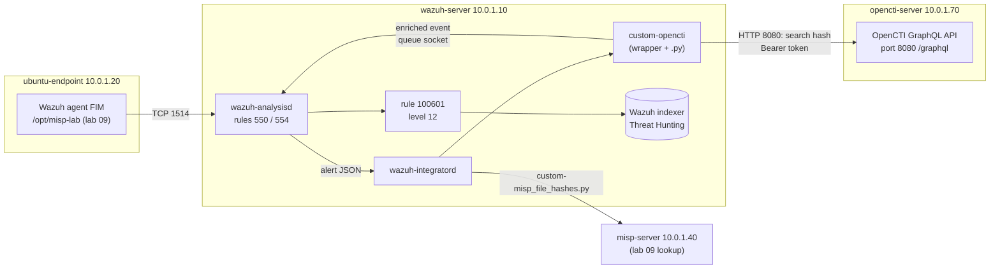

# Lab 18: Enrich Wazuh Alerts With OpenCTI

This lab adds a custom Wazuh integration that asks OpenCTI about every file hash in a file integrity alert. When OpenCTI knows the hash, the script sends a new enriched event back into Wazuh with the malware family labels, the source (author) and the confidence score, and a new rule raises it to level 12. The MISP lookup from lab 09 keeps running on the same alerts, so one file event gets both answers: MISP says the hash is known, OpenCTI says what it is.

## What this lab covers

- [Part A: Install the custom-opencti integration](#part-a-install-the-custom-opencti-integration): a Python script and its wrapper on `wazuh-server`
- [Part B: Add the rules for the enriched event](#part-b-add-the-rules-for-the-enriched-event): rules 100600 and 100601
- [Part C: Connect Wazuh to OpenCTI](#part-c-connect-wazuh-to-opencti): register the integration for FIM alerts 550 and 554

## Architecture



Data flow: the agent reports a new or changed file (rule 554 or 550) with its MD5, SHA-1 and SHA-256 hashes. `wazuh-integratord` (the Wazuh service that runs integrations) writes the alert to a file and starts `custom-opencti`. The script searches OpenCTI's GraphQL API for each hash. GraphQL is the query language of OpenCTI's API, served at `/graphql`. On an exact match, the script writes an enriched event into Wazuh's queue socket, and rule 100601 turns it into a level 12 alert.

## What you need

### Existing labs used

| Lab | What it gives this lab |
|---|---|
| [01-wazuh-soc-lab](../01-wazuh-soc-lab/) | Wazuh 4.14 on `wazuh-server` and the agent on `ubuntu-endpoint` |
| [09-wazuh-misp-lab](../09-wazuh-misp-lab/) | FIM with hashes on `/opt/misp-lab` (Part C), the MISP lookup on rule 554, and the EICAR test event in MISP |
| [16-opencti-lab](../16-opencti-lab/) | OpenCTI on `opencti-server`, port 8080, admin token in `/root/opencti/docker/.env` |
| [17-opencti-misp-lab](../17-opencti-misp-lab/) | Your MISP indicators (and the lab 09 EICAR hash) inside OpenCTI |

### VM table

No new VM.

| VM name | Role in this lab | Private IP | CPU | RAM | Disk |
|---|---|---|---|---|---|
| wazuh-server | Runs the integration and the rules | 10.0.1.10 | 4 vCPU | 8 GB | 50 GB |
| ubuntu-endpoint | Produces FIM alerts with hashes | 10.0.1.20 | 1 vCPU | 2 GB | 20 GB |
| opencti-server | Answers the hash lookups | 10.0.1.70 | 8 vCPU | 16 GB | 50 GB |
| misp-server | Lab 09 lookup on the same alerts | 10.0.1.40 | 2 vCPU | 8 GB | 50 GB |

### Placeholder table

| Placeholder | Example value | Where to find or set it |
|---|---|---|
| `<OPENCTI_IP>` | 10.0.1.70 | On `opencti-server`: `hostname -I` (first address) |
| `<OPENCTI_TOKEN>` | (a UUID) | On `opencti-server`: `sudo grep '^OPENCTI_ADMIN_TOKEN=' /root/opencti/docker/.env \| cut -d= -f2-` |
| `<TEST_HASH>` | (an MD5, SHA-1 or SHA-256) | OpenCTI: **Observations** → **Indicators** → open one from your MISP feeds → copy its **Name** |

### Where secrets live

- The OpenCTI token is the lab 16 admin token. It ends up in `/var/ossec/etc/ossec.conf` on `wazuh-server` (readable only by root and the `wazuh` group). Save it in your password manager too.
- This token can change and delete everything in OpenCTI. Never upload `ossec.conf`, never paste the token into a chat, and replace it with a read-only user later (see [Next steps](#next-steps)).
- Steps that need the token read it with `read -rsp`, so it is not shown or kept in the shell history.
- Run the manual test (T1) from a root shell (`sudo -i`), not with `sudo <command>`. `sudo` writes the full command line, token included, to the system log, and Wazuh then stores that line as an alert (rule 5402).

## Part A: Install the custom-opencti integration

**Run on: wazuh-server**

### A1. Test the OpenCTI API from wazuh-server

```bash
OPENCTI_IP="10.0.1.70"   # CHANGE THIS: <OPENCTI_IP>
read -rsp "Paste the OpenCTI token: " OPENCTI_TOKEN; echo
curl -s -X POST "http://${OPENCTI_IP}:8080/graphql" \
  -H "Content-Type: application/json" \
  -H "Authorization: Bearer ${OPENCTI_TOKEN}" \
  -d '{"query":"{ about { version } }"}'; echo
unset OPENCTI_TOKEN
```

What it does: sends the smallest possible GraphQL query (the OpenCTI version) from `wazuh-server` to OpenCTI with the token. This is the same network path and login the integration will use.

**Check:** expected output (similar to):

```
{"data":{"about":{"version":"7.x.x"}}}
```

`AUTH_REQUIRED` means the token is wrong. No answer at all means `wazuh-server` cannot reach `10.0.1.70:8080`. Do not continue until you see a version.

### A2. Create the script

```bash
sudo tee /var/ossec/integrations/custom-opencti.py > /dev/null <<'EOF'
#!/var/ossec/framework/python/bin/python3
# Lab 18: Wazuh -> OpenCTI enrichment.
# Save as /var/ossec/integrations/custom-opencti.py on wazuh-server.
# Wazuh (wazuh-integratord) runs it for every alert listed in <rule_id>,
# with: alert file, API key (OpenCTI token), hook URL (OpenCTI /graphql).
import json
import sys
import time
from socket import socket, AF_UNIX, SOCK_DGRAM

SOCKET_ADDR = '/var/ossec/queue/sockets/queue'
DEBUG = False
LOG_FILE = '/var/ossec/logs/opencti-integration.log'


def debug(msg):
    if DEBUG:
        with open(LOG_FILE, 'a') as f:
            f.write(f"{time.strftime('%Y-%m-%d %H:%M:%S')} {msg}\n")


def send_event(msg, agent=None):
    """Send the enriched event back into Wazuh's analysis queue."""
    if not agent or agent.get('id') == '000':
        payload = f'1:opencti:{json.dumps(msg)}'
    else:
        name = agent.get('name', '').replace('|', '')
        payload = f"1:[{agent['id']}] ({name}) {agent.get('ip', 'any')}->opencti:{json.dumps(msg)}"
    debug(f"SEND: {payload[:300]}")
    s = socket(AF_UNIX, SOCK_DGRAM)
    s.connect(SOCKET_ADDR)
    s.send(payload.encode())
    s.close()


def query_opencti(url, token, value):
    """Search OpenCTI indicators for the hash (full-text search)."""
    import requests
    query = """
    query Search($search: String) {
      indicators(search: $search, first: 5) {
        edges {
          node {
            id
            name
            pattern
            x_opencti_score
            valid_until
            createdBy { ... on Identity { name } }
            objectLabel { value }
          }
        }
      }
    }
    """
    resp = requests.post(
        url,
        headers={'Content-Type': 'application/json',
                 'Authorization': f'Bearer {token}'},
        json={'query': query, 'variables': {'search': value}},
        timeout=20
    )
    resp.raise_for_status()
    return resp.json()


def exact_match(edges, value):
    """Search is fuzzy: keep only an indicator whose name or pattern holds the exact hash."""
    v = value.lower()
    for edge in edges:
        node = edge.get('node') or {}
        if v == (node.get('name') or '').lower() or v in (node.get('pattern') or '').lower():
            return node
    return None


def extract_hashes(alert):
    """Pull every file hash out of the alert (FIM and decoded fields)."""
    found = []
    syscheck = alert.get('syscheck', {})
    data = alert.get('data', {})
    for key in ('sha256_after', 'sha1_after', 'md5_after'):
        if syscheck.get(key):
            found.append(syscheck[key])
    for key in ('sha256', 'sha1', 'md5'):
        if data.get(key):
            found.append(data[key])
    return list(dict.fromkeys(found))


def main():
    alert_file = sys.argv[1]
    token = sys.argv[2]
    hook_url = sys.argv[3]

    with open(alert_file) as f:
        alert = json.load(f)

    agent = alert.get('agent', {})
    hashes = extract_hashes(alert)
    debug(f"Alert {alert.get('rule', {}).get('id')} -> hashes: {hashes}")

    for value in hashes:
        try:
            result = query_opencti(hook_url, token, value)
        except Exception as e:
            debug(f"QUERY FAILED for {value}: {e}")
            continue

        if result.get('errors'):
            debug(f"GRAPHQL ERROR for {value}: {result['errors']}")
            continue

        edges = ((result.get('data') or {}).get('indicators') or {}).get('edges', [])
        node = exact_match(edges, value)
        if not node:
            debug(f"No match for {value}")
            continue

        labels = [label['value'] for label in (node.get('objectLabel') or [])]
        author = (node.get('createdBy') or {}).get('name', 'unknown')

        send_event({
            'integration': 'opencti',
            'opencti': {
                'found': 1,
                'ioc_type': 'hash',
                'value': value,
                'indicator_id': node.get('id'),
                'score': node.get('x_opencti_score'),
                'valid_until': node.get('valid_until'),
                'author': author,
                'labels': labels,
                'source_rule': alert.get('rule', {}).get('id'),
                'source_description': alert.get('rule', {}).get('description'),
                'source_file': alert.get('syscheck', {}).get('path'),
            }
        }, agent)
        break  # one enriched event per alert


if __name__ == '__main__':
    main()
EOF
```

What it does: writes the integration script, also in [configs/custom-opencti.py](configs/custom-opencti.py). For each hash in the alert (SHA-256, SHA-1, MD5) it runs an OpenCTI `search`, keeps a result only when the indicator's name or pattern holds that exact hash, and sends one enriched event for the first match. The event carries the labels (malware family), author (source), score (confidence), indicator ID, and the file path.

### A3. Create the wrapper

```bash
sudo tee /var/ossec/integrations/custom-opencti > /dev/null <<'EOF'
#!/bin/sh
# Lab 18: wrapper for custom-opencti.py.
# Save as /var/ossec/integrations/custom-opencti on wazuh-server.
# It runs custom-opencti.py with Wazuh's own Python and passes all arguments on.
WPYTHON_BIN="framework/python/bin/python3"
SCRIPT_PATH_NAME="$0"
DIR_NAME="$(cd $(dirname ${SCRIPT_PATH_NAME}); pwd -P)"
SCRIPT_NAME="$(basename ${SCRIPT_PATH_NAME})"

case ${DIR_NAME} in
    */active-response/bin | */wodles*)
        if [ -z "${WAZUH_PATH}" ]; then
            WAZUH_PATH="$(cd ${DIR_NAME}/../..; pwd)"
        fi
        PYTHON_SCRIPT="${DIR_NAME}/${SCRIPT_NAME}.py"
    ;;
    */bin)
        if [ -z "${WAZUH_PATH}" ]; then
            WAZUH_PATH="$(cd ${DIR_NAME}/..; pwd)"
        fi
        PYTHON_SCRIPT="${WAZUH_PATH}/framework/scripts/${SCRIPT_NAME}.py"
    ;;
    */integrations)
        if [ -z "${WAZUH_PATH}" ]; then
            WAZUH_PATH="$(cd ${DIR_NAME}/..; pwd)"
        fi
        PYTHON_SCRIPT="${DIR_NAME}/${SCRIPT_NAME}.py"
    ;;
esac

${WAZUH_PATH}/${WPYTHON_BIN} ${PYTHON_SCRIPT} "$@"
EOF
```

What it does: Wazuh runs the file named in the integration (`custom-opencti`, no `.py`). This small shell script, also in [configs/custom-opencti](configs/custom-opencti), starts `custom-opencti.py` with Wazuh's own Python (`/var/ossec/framework/python/bin/python3`), which already has the `requests` library.

### A4. Set the owner and permissions

```bash
sudo chown root:wazuh /var/ossec/integrations/custom-opencti /var/ossec/integrations/custom-opencti.py
sudo chmod 750 /var/ossec/integrations/custom-opencti /var/ossec/integrations/custom-opencti.py
```

What it does: lets the `wazuh` group run both files and nobody else change them. With wrong permissions the integration never runs and logs nothing useful.

**Check:**

```bash
ls -l /var/ossec/integrations/custom-opencti*
sudo /var/ossec/framework/python/bin/python3 -c "import ast,sys; ast.parse(open(sys.argv[1]).read()); print('OK')" /var/ossec/integrations/custom-opencti.py
```

Expected output (similar to):

```
-rwxr-x--- 1 root wazuh  ... /var/ossec/integrations/custom-opencti
-rwxr-x--- 1 root wazuh  ... /var/ossec/integrations/custom-opencti.py
OK
```

## Part B: Add the rules for the enriched event

**Run on: wazuh-server**

### B1. Create the rules file

```bash
sudo tee /var/ossec/etc/rules/opencti_rules.xml > /dev/null <<'EOF'
<!--
  Lab 18: rules for the OpenCTI enriched event.
  File: /var/ossec/etc/rules/opencti_rules.xml on wazuh-server.
  Rule IDs 100600-100601 (not used by any earlier lab).
-->
<group name="opencti,threat_intel,">

  <rule id="100600" level="3">
    <decoded_as>json</decoded_as>
    <field name="integration">opencti</field>
    <description>OpenCTI integration event</description>
    <options>no_full_log</options>
  </rule>

  <rule id="100601" level="12">
    <if_sid>100600</if_sid>
    <field name="opencti.found">1</field>
    <description>OpenCTI: IOC $(opencti.value) matched known indicator (author: $(opencti.author))</description>
    <options>no_full_log</options>
  </rule>

</group>
EOF
sudo chown wazuh:wazuh /var/ossec/etc/rules/opencti_rules.xml
sudo chmod 660 /var/ossec/etc/rules/opencti_rules.xml
sudo /var/ossec/bin/wazuh-analysisd -t && sudo systemctl restart wazuh-manager
```

What it does: adds a separate rules file, also in [configs/opencti_rules.xml](configs/opencti_rules.xml), so `local_rules.xml` is not changed. Rule 100600 (level 3) matches any event whose JSON field `integration` is `opencti`. Rule 100601 (level 12) matches when `opencti.found` is `1` and names the hash and the author. `wazuh-analysisd -t` checks every rule before the restart.

**Check:** feed a sample enriched event to `wazuh-logtest`, Wazuh's rule tester:

```bash
echo '{"integration": "opencti", "opencti": {"found": 1, "value": "test", "author": "abuse.ch"}}' | sudo /var/ossec/bin/wazuh-logtest
```

Expected output, at the end (similar to):

```
**Phase 3: Completed filtering (rules).
	id: '100601'
	level: '12'
	description: 'OpenCTI: IOC test matched known indicator (author: abuse.ch)'
	groups: '['opencti', 'threat_intel']'
**Alert to be generated.
```

## Part C: Connect Wazuh to OpenCTI

**Run on: wazuh-server** (run all lines in the same terminal)

### C1. Register the integration

```bash
OPENCTI_IP="10.0.1.70"   # CHANGE THIS: <OPENCTI_IP>
read -rsp "Paste the OpenCTI token: " OPENCTI_TOKEN; echo
sudo tee -a /var/ossec/etc/ossec.conf > /dev/null <<EOF

<ossec_config>
  <integration>
    <name>custom-opencti</name>
    <hook_url>http://${OPENCTI_IP}:8080/graphql</hook_url>
    <api_key>${OPENCTI_TOKEN}</api_key>
    <rule_id>550,554</rule_id>
    <alert_format>json</alert_format>
  </integration>
</ossec_config>
EOF
unset OPENCTI_TOKEN
sudo /var/ossec/bin/wazuh-analysisd -t && sudo systemctl restart wazuh-manager
```

What it does: adds a new `<ossec_config>` block to the end of `ossec.conf`; the blocks from earlier labs are not changed. The settings:

| Setting | Meaning |
|---|---|
| `name` | The file in `/var/ossec/integrations` to run. Custom integrations must start with `custom-` |
| `hook_url` | OpenCTI's GraphQL address. The script receives it as its third argument |
| `api_key` | The OpenCTI token. The script receives it as its second argument |
| `rule_id` | Only these alerts start the script: 550 (file changed) and 554 (file added). Each one costs one to three OpenCTI queries, so keep the list short |
| `alert_format` | `json`: the script receives the full alert as JSON |

**Check:**

```bash
sudo grep "custom-opencti" /var/ossec/logs/ossec.log | tail -n 1
```

Expected output (similar to):

```
wazuh-integratord: INFO: Enabling integration for: 'custom-opencti'.
```

## Test

### T1. Test alert with a hash from OpenCTI

This is a manual run of the script with a made-up alert that holds a hash you can already see in OpenCTI.

1. In OpenCTI (`http://10.0.1.70:8080`): **Observations** → **Indicators** → open an indicator from your MISP feeds (author, for example, `abuse.ch`) → copy its **Name**. This is `<TEST_HASH>`.
2. On **wazuh-server**, open a root shell first (type it on its own, and enter your password if asked):

```bash
sudo -i
```

   Then run:

```bash
sed -i 's/^DEBUG = False/DEBUG = True/' /var/ossec/integrations/custom-opencti.py
TEST_HASH='<TEST_HASH>'   # CHANGE THIS
cat > /tmp/test-alert.json << EOF
{
  "rule": {"id": "550", "description": "Test"},
  "agent": {"id": "000", "name": "wazuh-server"},
  "syscheck": {"path": "/tmp/test", "sha256_after": "${TEST_HASH}"}
}
EOF
read -rsp "Paste the OpenCTI token: " OPENCTI_TOKEN; echo
/var/ossec/integrations/custom-opencti /tmp/test-alert.json "${OPENCTI_TOKEN}" http://10.0.1.70:8080/graphql
unset OPENCTI_TOKEN
tail -n 3 /var/ossec/logs/opencti-integration.log
```

What it does: turns on the debug log, writes a test alert (any hash type works in that field; the script searches by value), and runs the integration exactly as Wazuh would.

Expected log lines (similar to):

```
... Alert 550 -> hashes: ['<TEST_HASH>']
... SEND: 1:opencti:{"integration": "opencti", "opencti": {"found": 1, ... "score": 60, ... "author": "abuse.ch", "labels": ["Malgent", "OSINT", ...
```

3. Check the alert, then turn the debug log off and leave the root shell:

```bash
grep '"id":"100601"' /var/ossec/logs/alerts/alerts.json | tail -n 1
sed -i 's/^DEBUG = True/DEBUG = False/' /var/ossec/integrations/custom-opencti.py
rm -f /tmp/test-alert.json
exit
```

4. In the Wazuh dashboard: ☰ → **Threat intelligence** → **Threat Hunting** → **Events** tab, time range **Last 15 minutes**, search:

```text
rule.id:100601
```

Expected: one level 12 alert, `OpenCTI: IOC <TEST_HASH> matched known indicator (author: abuse.ch)`. Expand it: `data.opencti.labels` (malware family), `data.opencti.author` (source), `data.opencti.score` (confidence) and `data.opencti.indicator_id`.

### T2. Real FIM alert: MISP and OpenCTI answers on one file

The EICAR test file is harmless. Lab 09 put its MD5 (`44d88612fea8a8f36de82e1278abb02f`) in MISP, and lab 17 copied it into OpenCTI.

1. In OpenCTI, type `44d88612fea8a8f36de82e1278abb02f` in the top search bar. Expected: an indicator with that name.
2. On **ubuntu-endpoint**:

```bash
sudo rm -f /opt/misp-lab/eicar.com
curl -sSLo /tmp/eicar.com https://secure.eicar.org/eicar.com
sudo mv /tmp/eicar.com /opt/misp-lab/eicar.com
```

What it does: removes an old copy from lab 09, downloads EICAR and moves the complete file into the watched folder, which gives a fresh rule 554 alert.

3. Threat Hunting, **Last 15 minutes**, search:

```text
rule.id:(554 or 100802 or 100601)
```

Expected (similar to):

| Rule | Level | Description |
|---|---|---|
| 554 | 5 | File added to the system. |
| 100802 | 12 | MISP: file hash matched (lab 09) |
| 100601 | 12 | OpenCTI: IOC 44d88612fea8a8f36de82e1278abb02f matched known indicator |

In 100601, `data.opencti.source_file` is `/opt/misp-lab/eicar.com`.

## Common problems

| Problem | Fix |
|---|---|
| A1 or the debug log shows `AUTH_REQUIRED` / `You must be logged in to do this` | The token is wrong or still a placeholder. Copy `OPENCTI_ADMIN_TOKEN` from lab 16's `.env` again. In `ossec.conf`, fix the `<api_key>` of the `custom-opencti` block and restart the manager |
| `ossec.log` shows `Couldn't execute command (...). Check file and permissions.` or `File not found inside` | Run A4 again: both files must exist, owned by `root:wazuh`, mode `750` |
| The debug log has a `SEND:` line but no 100601 alert | The rules did not load. Check the B1 `wazuh-logtest` output and that `opencti_rules.xml` is owned by `wazuh:wazuh` |
| A changed file in `/etc` never starts the script | Default folders are scanned only every 12 hours (`frequency 43200`). Test in a folder with `realtime="yes"`, such as `/opt/misp-lab` from lab 09 |
| `No match` for a hash you can see in OpenCTI | Check the exact hash text and that the indicator exists (OpenCTI search bar). If the OpenCTI import queue is long (lab 17 step B6), wait until it drains |

## Next steps

- Replace the admin token with a dedicated read-only OpenCTI user for Wazuh: [OpenCTI users and RBAC](https://docs.opencti.io/latest/administration/users/)
- Choose which alerts start the lookup (`rule_id`, `group`, `level`): [Wazuh integration reference](https://documentation.wazuh.com/current/user-manual/reference/ossec-conf/integration.html)
- More about custom integrations and `wazuh-integratord`: [Wazuh external API integration](https://documentation.wazuh.com/current/user-manual/manager/integration-with-external-apis.html)
