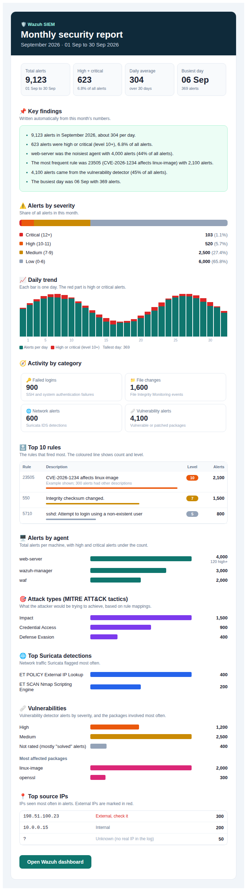

# 03 · Monthly security report

> Part of the **Wazuh + n8n SOC Automation** project (9 workflows). Start with [00-setup](00-setup/) if n8n isn't installed yet.

On the 1st of every month, a full report for the month that just ended.



```
Schedule (1st of month)  →  HTTP Request (Wazuh indexer)  →  Code (build report)  →  Send Email
```

The report includes: totals and daily average (each compared with the previous month), busiest day, automatically written key findings, alerts by severity, a daily trend chart, activity by category (failed logins, file changes, network alerts, vulnerabilities), top 10 rules, alerts per agent, MITRE ATT&CK tactics, top Suricata signatures, vulnerabilities by severity and package, and top source IPs.

**Prerequisites:** [00-setup](00-setup/) (n8n, SMTP and **Wazuh indexer** credentials).

**Files**

| File | Used in |
|------|---------|
| `monthly-query.json` | HTTP Request body – the previous full month (for the automatic run) |
| `monthly-query-this-month.json` | HTTP Request body – the current month so far (for testing) |
| `build-monthly-report.js` | Code node |

---

## Step 1 · Build the workflow

Create a workflow named **Wazuh monthly report**.

**1. Schedule Trigger**

| Setting | Value |
|---------|-------|
| Trigger Interval | Months |
| Day of Month | 1 |
| Hour | 9am |

**2. HTTP Request** (rename it `Wazuh indexer`) – same settings as the daily report (**02-daily-report**): POST `https://127.0.0.1:9200/wazuh-alerts-*/_search`, Basic Auth **Wazuh indexer**, Send Body JSON, Ignore SSL Issues on. Paste `monthly-query.json` as the JSON body.

**3. Code** (rename it `Build monthly report`) – paste `build-monthly-report.js`. Set at the top:

```js
const MODE = 'last_month';                              // 'this_month' for testing
const DASHBOARD_URL = 'https://YOUR-WAZUH-DASHBOARD';
```

**4. Send Email** – Subject `{{ $json.subject }}`, Email Format HTML, HTML `{{ $json.html }}`.

**Save** and **Publish**.

## Step 2 · Test without waiting for the 1st

1. Temporarily paste `monthly-query-this-month.json` into the HTTP Request body.
2. Set `const MODE = 'this_month';` in the Code node.
3. Click **Execute workflow** – you get a report for the current month so far.
4. Put `monthly-query.json` and `MODE = 'last_month'` back, then **Publish**.

## Notes

- **Timezone.** "Last month" is calculated in the queries with `"time_zone": "+06:00"`. Change it to yours, otherwise each month starts and ends at the wrong hour (at UTC midnight, which was 6 AM for me).
- **Charts without scripts.** Email apps don't run JavaScript, so every chart is built from table cells with background colours.
- **Read the first report carefully.** In my lab, 45% of all alerts came from the vulnerability detector (mostly kernel updates), and the top MITRE tactic, *Impact*, came mostly from file-change alerts that updates trigger. Seen one by one these looked important; seen as a month they were mostly normal system activity.
- **Wrong labels mislead.** An alert with `?` as its source IP was first labelled as an external IP to check. It's now labelled *Unknown (no real IP in the log)*.
