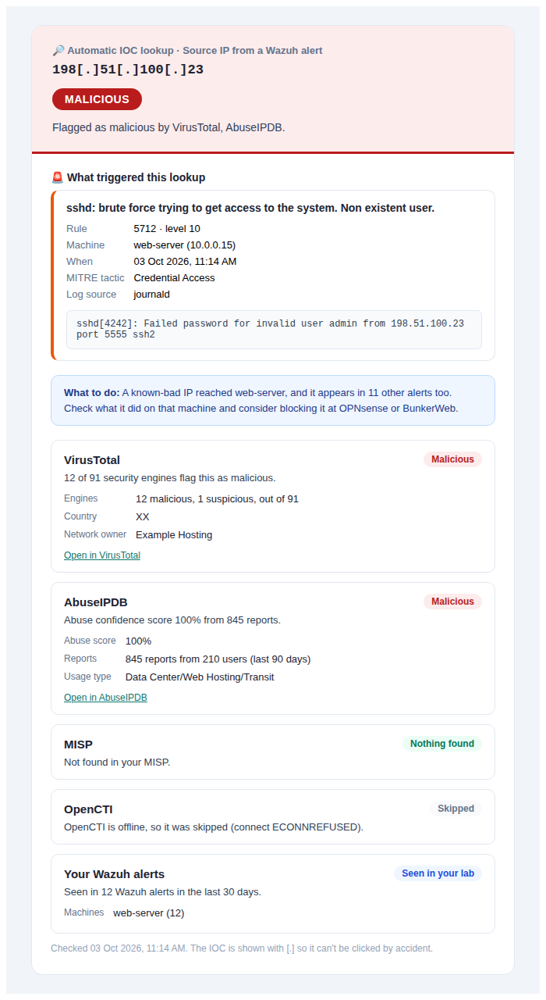

# 06 · Automatic IOC lookup + verdicts back into Wazuh

> Part of the **Wazuh + n8n SOC Automation** project (9 workflows). Start with [00-setup](00-setup/) if n8n isn't installed yet.

When Wazuh raises an alert with an **external source IP**, n8n checks that IP automatically against VirusTotal, AbuseIPDB, MISP, OpenCTI and your own alerts. If the IP is bad it:

1. **emails you** the verdict, with the alert that triggered it and a suggested next step, and
2. **sends the verdict back into Wazuh** through the Wazuh API, where custom rules turn it into an alert you can search in the dashboard.



```
Wazuh alert (level ≥ 5)  ──custom-n8n──→  Webhook
  → Detect IOC                       (find a public source IP, skip everything else)
  → Checked in last 24h?             (Data Table: stop if this IP was already checked)
       ├→ Remember IP                (Data Table: save IP + time)
       └→ VirusTotal → Is public IP? → AbuseIPDB → MISP → OpenCTI → Wazuh
  → Build verdict
       ├→ If (notify)        → Send Email
       └→ Send to Wazuh?     → Wazuh API login → Send verdict to Wazuh
                                                     ↓
                                    Wazuh rule 100951 (MALICIOUS) / 100952 (SUSPICIOUS)
```

**Prerequisites:** [00-setup](00-setup/) with **all** credentials (including **Wazuh API**). It helps to build **05-ioc-lookup-form** first – the five source nodes are configured the same way.

**Files**

| File | Used in |
|------|---------|
| `detect-ioc.js` | Code node **Detect IOC** |
| `build-verdict.js` | Code node **Build verdict** |
| `wazuh/n8n_ioc_rules.xml` | `/var/ossec/etc/rules/n8n_ioc_rules.xml` |
| `wazuh/ossec-integration.xml` | `/var/ossec/etc/ossec.conf` |

---

## What gets checked, and what doesn't

Being selective is most of the work. Without these rules, one port scan would use up VirusTotal's free limit (4 lookups/minute) and fill your inbox with the same IP.

| Skipped | Why |
|---------|-----|
| Private IPs (`10.x`, `192.168.x`, `172.16–31.x`, …) | Those are your own machines |
| Values like `?` | Some logs have no real address |
| Vulnerability, SCA, file-integrity and rootcheck alerts | They never contain an attacker IP |
| The same IP again within 24 hours | A brute force with 50 alerts = 1 lookup, 1 email |
| Clean results | No email needed (configurable) |

Wazuh decoders call the field `data.srcip`; Suricata calls it `data.src_ip`. Detect IOC checks both.

---

## Part A · Wazuh: rules for the verdict events

**1. Install the rules**

```bash
sudo nano /var/ossec/etc/rules/n8n_ioc_rules.xml        # paste wazuh/n8n_ioc_rules.xml
sudo chown wazuh:wazuh /var/ossec/etc/rules/n8n_ioc_rules.xml
sudo chmod 660 /var/ossec/etc/rules/n8n_ioc_rules.xml
sudo /var/ossec/bin/wazuh-analysisd -t                   # config test, must end without errors
sudo systemctl restart wazuh-manager
```

| Rule | Level | Fires when |
|------|-------|------------|
| 100950 | 3 | Any verdict event from n8n (base rule) |
| 100951 | 9 | Verdict is MALICIOUS |
| 100952 | 6 | Verdict is SUSPICIOUS |

Check the IDs don't clash with your own rules: `sudo grep -rn 'id="1009' /var/ossec/etc/rules/`

**2. Test the Wazuh API by hand** – before building anything in n8n:

```bash
read -s -p "Wazuh API password: " WPASS; echo
TOKEN=$(curl -s -k -u "wazuh-wui:$WPASS" -X POST "https://127.0.0.1:55000/security/user/authenticate?raw=true")
echo "Token length: ${#TOKEN}"          # a few hundred characters; under 100 means the login failed

curl -s -k -X POST "https://127.0.0.1:55000/events" \
  -H "Authorization: Bearer $TOKEN" -H "Content-Type: application/json" \
  -d '{"events":["{\"n8n_ioc\":{\"source\":\"n8n\",\"ip\":\"203.0.113.45\",\"verdict\":\"MALICIOUS\",\"flagged_by\":\"API test\",\"agent\":\"test-agent\"}}"]}'
# → "total_affected_items": 1

sleep 5; sudo grep "n8n_ioc" /var/ossec/logs/alerts/alerts.json | tail -n 1
# → rule 100951, decoder "json", location "API-Webhook"
```

All three commands must run in the same terminal – if `$TOKEN` is empty you get `Invalid token`. The token is valid for about 15 minutes.

> `POST /events` exists in Wazuh 4.x. Check your version's API reference; Wazuh has announced it may be removed in a future major version.

---

## Part B · n8n: the "already checked" table

On the n8n home page → **Data tables** → create **`ioc_checked`** with two columns:

| Column | Type |
|--------|------|
| `ip` | String |
| `checked_at` | Date |

Also make sure `N8N_CONCURRENCY_PRODUCTION_LIMIT=1` is in your compose file ([00-setup](00-setup/)). The two together are what make "once per 24 hours" reliable – see *Why the Data Table* below.

---

## Part C · n8n: build the workflow

Create a workflow named **Automatic IOC lookup**. Node names must match exactly.

| # | Node | Settings |
|---|------|----------|
| 1 | **Webhook** `wazuh-ioc` | POST · Path `wazuh-ioc` · Authentication None · Respond Immediately |
| 2 | **Code** `Detect IOC` | paste `detect-ioc.js` |
| 3 | **Data Table** `Checked in last 24h?` | Operation *If Row Does Not Exist* · table `ioc_checked` · Must match *All Conditions* · `ip` **Equals** `{{ $('Detect IOC').first().json.ioc }}` · `checked_at` **Greater Than** `{{ $now.minus({ hours: 24 }).toISO() }}` |
| 4 | **Data Table** `Remember IP` | Operation *Upsert Row* · table `ioc_checked` · condition `ip` **Equals** `{{ $('Detect IOC').first().json.ioc }}` · columns `ip` = `{{ $('Detect IOC').first().json.ioc }}`, `checked_at` = `{{ $now.toISO() }}` |
| 5–10 | **VirusTotal**, **Is public IP?**, **AbuseIPDB**, **MISP**, **OpenCTI**, **Wazuh** | exactly as in **05-ioc-lookup-form** (Include Response Headers and Status, Never Error, On Error: Continue) |
| 11 | **Code** `Build verdict` | paste `build-verdict.js` |
| 12 | **If** `If` | `{{ $json.notify }}` is true (Boolean) → **Send Email** (Subject `{{ $json.subject }}`, HTML `{{ $json.html }}`) |
| 13 | **If** `Send to Wazuh?` | `{{ $json.sendToWazuh }}` is true (Boolean) |
| 14 | **HTTP Request** `Wazuh API login` | POST `https://127.0.0.1:55000/security/user/authenticate` · Basic Auth → **Wazuh API** · Ignore SSL Issues on |
| 15 | **HTTP Request** `Send verdict to Wazuh` | POST `https://127.0.0.1:55000/events` · Header `Authorization` = `Bearer {{ $json.data.token }}` · JSON body `{{ JSON.stringify($('Build verdict').first().json.wazuhEventsBody) }}` · Ignore SSL Issues on |

**Connections**

- `Checked in last 24h?` connects to **both** `Remember IP` and `VirusTotal`. Place `Remember IP` **higher** on the canvas – n8n runs the higher branch first, so the IP is saved before the slow lookups start.
- `Build verdict` connects to **both** `If` (email) and `Send to Wazuh?`.

**Settings at the top of `Build verdict`**

```js
const EMAIL_ON = ['MALICIOUS', 'SUSPICIOUS'];  // add 'NOT CHECKED', 'INCOMPLETE CHECK' to hear about broken sources
const WAZUH_ON = ['MALICIOUS', 'SUSPICIOUS'];  // verdicts sent back into Wazuh
const USE_OPENCTI = true;    // used when running, skipped automatically when offline
const MISP_LAB_EVENT_ID = '';  // set when you build 08-misp-feedback
const TEST_IP = '203.0.113.';  // any 203.0.113.x is forced MALICIOUS, for testing
```

**Save** and **Publish**.

---

## Part D · Wazuh: send alerts to the workflow

Add `wazuh/ossec-integration.xml` inside `<ossec_config>`, then restart:

```xml
<integration>
  <name>custom-n8n</name>
  <hook_url>http://localhost:5678/webhook/wazuh-ioc</hook_url>
  <level>5</level>
  <alert_format>json</alert_format>
</integration>
```

```bash
sudo systemctl restart wazuh-manager
```

---

## Part E · Test

**1. Fake brute force with a test IP** – on any Linux agent:

```bash
for i in $(seq 1 10); do logger -p auth.info -t "sshd[4242]" "Failed password for invalid user admin from 203.0.113.70 port 5555 ssh2"; sleep 1; done
```

**2. After about a minute**, on the manager:

```bash
sudo grep "203.0.113.70" /var/ossec/logs/alerts/alerts.json | grep -o '"rule":{[^}]*"id":"[0-9]*"' | grep -o '"id":"[0-9]*"' | sort | uniq -c
```

Expected: several `5710`, one `5712`, and **exactly one** `100951`. You also get **one** IOC email.

Use a new `203.0.113.x` each time – each IP is only checked once per 24 hours.

**3. In the dashboard:** Threat Hunting → search `rule.id:100951`. The `data.n8n_ioc.*` fields hold the verdict, sources, scores and the attacked agent (`data.n8n_ioc.agent`).

---

## Design notes

**Levels stay below 10.** The attack itself (rule 5712) already triggers the level-10 email from **01-wazuh-alert-email**. A level-10 verdict would email you twice about the same attack.

**The IP is stored as `n8n_ioc.ip`, not `srcip`.** This workflow checks every alert that has a source IP. If the verdict alert used `srcip`, it would trigger a new lookup of the same IP, which would send another verdict… a loop created by the automation itself.

**Verdict alerts show agent `000` and location `API-Webhook`.** They enter Wazuh through the manager's API, not from an agent. The attacked machine is in `data.n8n_ioc.agent`.

**Why the Data Table.** Detect IOC also keeps its own 24-hour memory, but n8n saves that memory only when a run *finishes*, and it loads a copy when an alert *arrives*. One test brute force gave me **7 verdicts and 7 emails** for the same IP, because the alerts arrived while the first lookup was still running. Running one execution at a time brought it down to 2. Moving the memory into a Data Table, which is read and written live, brought it to 1.

**OpenCTI is optional.** When it's down or unreachable it is *skipped* and the verdict comes from the other sources. A wrong token still counts as an error, because that's a setup problem you need to fix.

---

## Troubleshooting

| Symptom | Cause / fix |
|---------|-------------|
| You get the IOC email but no `100951` | The live workflow doesn't have the Wazuh branch – **Publish** it. Check for an **old copy** of the workflow still published on the same webhook path (n8n refuses to publish a second workflow on the same path). |
| `Send to Wazuh?` always goes **false** | Open the run → **Build verdict** output → `verdict`. `NOT CHECKED` / `INCOMPLETE CHECK` means sources failed – often credentials missing after **copying** a workflow (copies don't keep credentials). `NO KNOWN THREAT` means the IP is clean – use a `203.0.113.x` test IP. |
| Several `100951` for one attack | `N8N_CONCURRENCY_PRODUCTION_LIMIT=1` missing, or the Data Table nodes aren't connected as above |
| Run stops at **Detect IOC** with no output | Normal for alerts without a public IP, or an IP checked in the last 24 h |
| `Invalid token` from the API | `$TOKEN` empty – run the login line first, in the same terminal |
