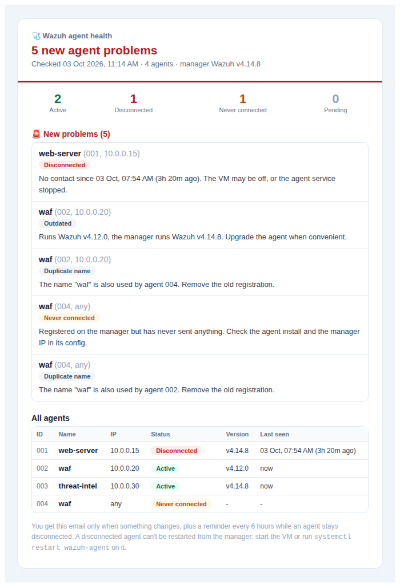

# 09 · Wazuh agent health

> Part of the **Wazuh + n8n SOC Automation** project (9 workflows). Start with [00-setup](00-setup/) if n8n isn't installed yet.

If a Wazuh agent stops, that machine raises no alerts at all – and *no alerts* looks exactly like *nothing happened*. This workflow checks every agent every 15 minutes and emails you when something changes.



```
Every 15 min → Wazuh API login → Get agents → Check agent health → If (something changed) → Send Email
```

| Problem | Meaning |
|---------|---------|
| **Disconnected** | VM off or agent service stopped. Shows when it was last seen. |
| **Never connected** | Registered on the manager but never sent anything |
| **Pending** | Started connecting but never finished – often a firewall or key problem |
| **Outdated** | Agent runs an older Wazuh version than the manager |
| **Duplicate name** | The same name registered twice, usually after reinstalling a VM |

**Only changes are emailed:** a new problem, or a problem that's resolved. Agents that stay disconnected get a reminder every 6 hours. Without this you'd get the same email every 15 minutes and stop reading them.

**It can't restart a disconnected agent.** The manager sends restart commands over the agent's own connection – the one that's broken. The email tells you what to check on that machine instead.

**Prerequisites:** [00-setup](00-setup/) (SMTP and **Wazuh API** credentials).

**Files:** `check-agent-health.js` – Code node **Check agent health**.

---

## Step 1 · Look at the data by hand

On the Wazuh manager, in one terminal:

```bash
read -s -p "Wazuh API password: " WPASS; echo
TOKEN=$(curl -s -k -u "wazuh-wui:$WPASS" -X POST "https://127.0.0.1:55000/security/user/authenticate?raw=true")
echo "Token length: ${#TOKEN}"
curl -s -k -H "Authorization: Bearer $TOKEN" \
  "https://127.0.0.1:55000/agents?limit=1000&select=id,name,ip,status,version,lastKeepAlive" | python3 -m json.tool
```

| Field | Meaning |
|-------|---------|
| `id` | Agent number – `000` is the manager itself |
| `status` | `active`, `disconnected`, `never_connected` or `pending` |
| `version` | Wazuh version on that agent |
| `lastKeepAlive` | When it last checked in |

> My first attempt returned `Invalid token`: I had only run the last command, so `$TOKEN` was empty. All lines must run in the same terminal, in order.

## Step 2 · Build the workflow

Create a workflow named **Wazuh Agent Health** (Settings → Error Workflow → Workflow Error Alerts).

| # | Node | Settings |
|---|------|----------|
| 1 | **Schedule Trigger** | Every 15 minutes |
| 2 | **HTTP Request** `Wazuh API login` | POST `https://127.0.0.1:55000/security/user/authenticate` · Basic Auth → **Wazuh API** · Ignore SSL Issues on. *Check:* output has `data.token` |
| 3 | **HTTP Request** `Get agents` | GET `https://127.0.0.1:55000/agents?limit=1000&select=id,name,ip,status,version,lastKeepAlive` · Header `Authorization` = `Bearer {{ $json.data.token }}` · Ignore SSL Issues on. *Check:* output has `data.affected_items` |
| 4 | **Code** `Check agent health` | paste `check-agent-health.js`. *Check:* output has `notify`, `subject` and a `problems` list |
| 5 | **If** | `{{ $json.notify }}` is true (Boolean) |
| 6 | **Send Email** (on true) | Subject `{{ $json.subject }}` · Email Format HTML · HTML `{{ $json.html }}` |

Settings at the top of the Code node:

```js
const REMIND_EVERY_HOURS = 6;   // reminder interval for agents that stay disconnected
const IGNORE_AGENTS = [];       // agent names to ignore, e.g. ['old-test-vm']
const TZ = 'Asia/Dhaka';
```

## Step 3 · Test manually

Click **Execute workflow**. You get an email listing your lab's current problems.

On a manual run every problem always counts as **new** – the "what did I report last time" memory only works in the published, scheduled workflow.

## Step 4 · Publish and test for real

1. **Publish.** The first scheduled run reports the current problems once; after that, only changes.
2. On a test VM (not the manager): `sudo systemctl stop wazuh-agent`
3. Wazuh marks it **disconnected** after a few minutes. The next run emails **"🔴 Wazuh agents: 1 new agent problem"**.
4. `sudo systemctl start wazuh-agent` → the next run emails **"🟢 Wazuh agents: 1 agent problem resolved"**.

## Fixing what it finds

| Problem | Fix |
|---------|-----|
| Disconnected | Start the VM, or `sudo systemctl restart wazuh-agent` on it; check it can reach the manager on ports 1514/1515 |
| Never connected / duplicate | Remove the old registration: `sudo /var/ossec/bin/manage_agents -r <ID>` on the manager |
| Outdated | Upgrade the agent package to the manager's version |
