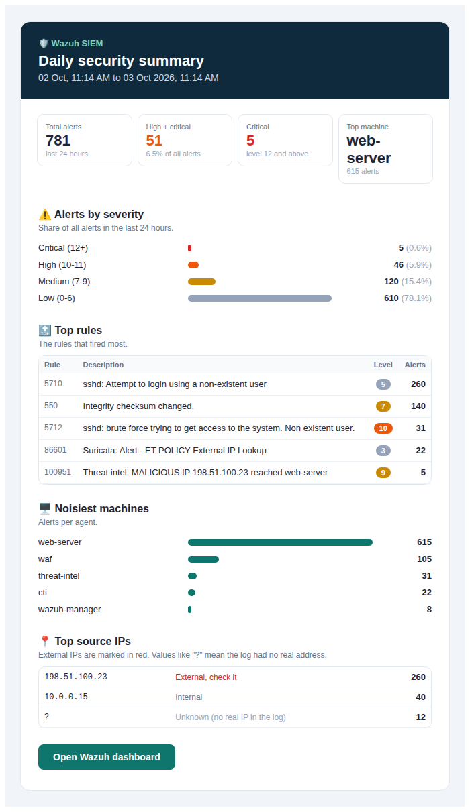

# 02 · Daily security summary

Every morning at 9 AM, an email summarising the last 24 hours: total alerts, severity breakdown, the rules that fired most, the noisiest machines and the most common source IPs.



```
Schedule (9 AM)  →  HTTP Request (Wazuh indexer)  →  Code (build report)  →  Send Email
```

This workflow **pulls** from the Wazuh indexer instead of waiting for alerts. The indexer does the counting itself (aggregations), so n8n receives a few totals instead of thousands of alerts, and the query answers in well under a second.

**Prerequisites:** [00-setup](../00-setup/) (n8n, SMTP and **Wazuh indexer** credentials).

**Files**

| File | Used in |
|------|---------|
| `daily-query.json` | HTTP Request node body |
| `build-daily-report.js` | Code node |

---

## Step 1 · Try the query by hand

Before building anything, check the indexer answers. On the Wazuh server:

```bash
read -s -p "Indexer password: " IPASS; echo
curl -s -k -u "admin:$IPASS" "https://127.0.0.1:9200/wazuh-alerts-*/_search?pretty" \
  -H "Content-Type: application/json" -d @daily-query.json | head -n 40
```

`read -s` hides the password and keeps it out of your shell history. You should see `"hits" : { "total" : { "value" : ... } }` and an `aggregations` section.

## Step 2 · Build the workflow

Create a workflow named **Wazuh daily report**.

**1. Schedule Trigger**

| Setting | Value |
|---------|-------|
| Trigger Interval | Days |
| Hour | 9am |

The hour uses the timezone from the compose file (`GENERIC_TIMEZONE`), or the workflow's own timezone under **⋯ → Settings**.

**2. HTTP Request** (rename it `Wazuh indexer`)

| Setting | Value |
|---------|-------|
| Method | POST |
| URL | `https://127.0.0.1:9200/wazuh-alerts-*/_search` |
| Authentication | Generic Credential Type → Basic Auth → **Wazuh indexer** |
| Send Body | On · Body Content Type **JSON** · Specify Body **Using JSON** |
| JSON | paste `daily-query.json` |
| Options → Ignore SSL Issues | On (the indexer uses a self-signed certificate) |

**3. Code** (rename it `Build daily report`) – JavaScript, *Run Once for All Items*. Paste `build-daily-report.js` and set at the top:

```js
const TZ = 'Asia/Dhaka';                               // your timezone
const DASHBOARD_URL = 'https://YOUR-WAZUH-DASHBOARD';  // your dashboard
```

**4. Send Email**

| Setting | Value |
|---------|-------|
| Subject | `{{ $json.subject }}` |
| Email Format | HTML |
| HTML | `{{ $json.html }}` |

**Save** and **Publish**.

## Step 3 · Test

Click **Execute workflow**. The email should arrive right away; after publishing it arrives every day at 9 AM.

## Notes

- If the indexer returns no data (wrong password, query not sent as JSON), the Code node **stops with an error** instead of emailing a report full of zeros. With [07](../07-workflow-error-alerts/) set up, you get an email about it.
- Source IPs are tagged **External, check it**, **Internal**, or **Unknown** – some logs carry `?` instead of a real address, and that shouldn't be reported as an external IP.
- My very first report caught two real things I hadn't noticed: dozens of alerts from a half-finished package install, and one machine repeatedly looking up its own public IP. Patterns show up in totals that you miss one alert at a time.
