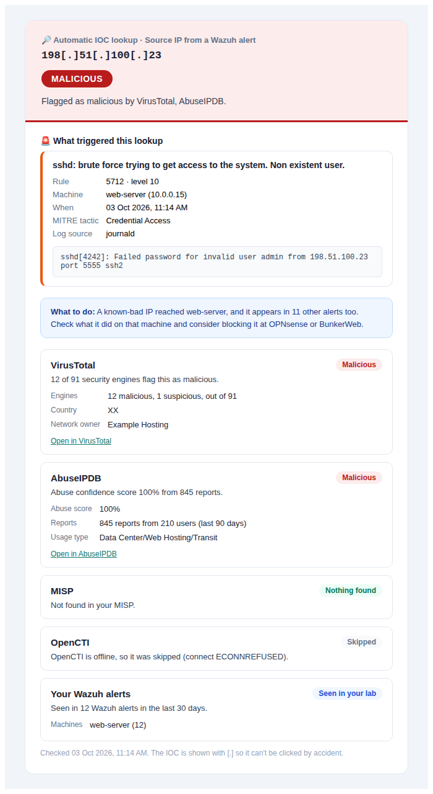
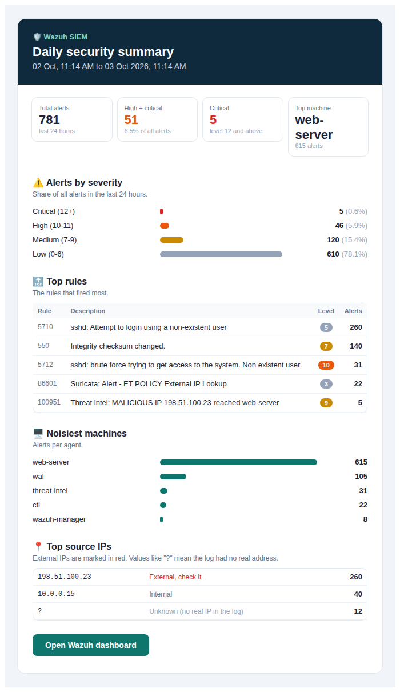
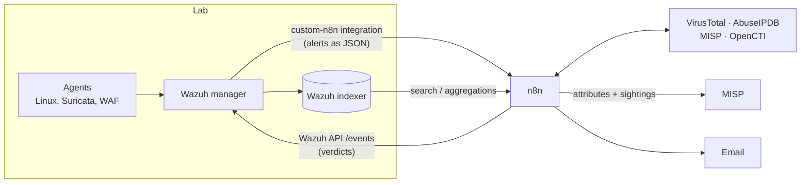

# Wazuh + n8n SOC Automation

Nine n8n workflows that turn a Wazuh SIEM lab into something that **tells you what matters** instead of waiting for you to open a dashboard: real-time alert emails, daily and monthly reports, automatic threat-intel lookups of attacker IPs, verdicts written back into Wazuh and MISP, agent health checks, and alerts when the automation itself breaks.

Everything here was built and tested step by step in my own hands-on SOC lab. Each folder is a complete, from-scratch guide for one workflow, with the code, queries and Wazuh configuration it needs.

<p align="center">
  
  &nbsp;
  
</p>

---

## The workflows

| # | Workflow | Trigger | What it does |
|---|----------|---------|--------------|
| [00](00-setup/) | **Setup** | – | Install n8n in Docker next to Wazuh, create credentials, install the Wazuh → n8n integration script |
| [01](01-wazuh-alert-email/) | **Wazuh alert email** | Wazuh alert (level ≥ 10) | Sends a clean HTML email for every serious alert |
| [02](02-daily-report/) | **Daily summary** | Every day, 9 AM | Last 24 h: totals, severity, top rules, noisiest machines, top source IPs |
| [03](03-monthly-report/) | **Monthly report** | 1st of every month | Full month: daily trend, severity, top rules, agents, MITRE tactics, Suricata, vulnerabilities, source IPs |
| [04](04-on-demand-report/) | **On-demand report** | Password-protected form | The monthly report for any month you choose |
| [05](05-ioc-lookup-form/) | **IOC lookup form** | Form | Checks an IP, domain, URL or hash against VirusTotal, AbuseIPDB, MISP, OpenCTI and your own Wazuh alerts |
| [06](06-auto-ioc-lookup/) | **Automatic IOC lookup** | Wazuh alert with a source IP | Looks up attacker IPs automatically, emails only bad ones, and sends the verdict back into Wazuh as an alert |
| [07](07-workflow-error-alerts/) | **Workflow error alerts** | Any workflow fails | Emails which workflow and step failed, the error, a likely cause and a link to the failed run |
| [08](08-misp-feedback/) | **MISP feedback** | Wazuh verdict alert (rule 100951) | Records malicious IPs seen in the lab in a MISP event and adds sightings |
| [09](09-agent-health/) | **Agent health** | Every 15 min | Emails when an agent disconnects, recovers, never connects, is outdated or duplicated |

## How it fits together



There are two ways data gets from Wazuh to n8n, and both are used:

- **Push** – Wazuh's integrator runs a small script (`custom-n8n`) that posts each matching alert to an n8n webhook. Used for anything that must happen right away (01, 06, 08).
- **Pull** – n8n asks the Wazuh indexer or API on a schedule. Used for reports and health checks (02, 03, 04, 09).

## Lab environment

| Component | Version / setup |
|-----------|-----------------|
| Wazuh manager, indexer, dashboard | 4.14.8, all-in-one on Ubuntu 24.04 |
| n8n | 2.40.5, Docker, on the same VM as Wazuh (`network_mode: host`) |
| MISP | 2.5, separate Ubuntu 24.04 VM |
| OpenCTI | Docker Compose, separate VM (optional – workflows skip it when it's down) |
| Also in the lab | Suricata, BunkerWeb (WAF), OPNsense (gateway), several Wazuh agents |

## Install order

1. **[00-setup](00-setup/)** – required by everything else.
2. **[07-workflow-error-alerts](07-workflow-error-alerts/)** – worth doing early, so you hear about failures in everything you build afterwards.
3. Any of **01–05** and **09**, in any order. They're independent.
4. **[06-auto-ioc-lookup](06-auto-ioc-lookup/)**, then **[08-misp-feedback](08-misp-feedback/)** – 08 is triggered by the verdict alerts that 06 creates.

## Placeholders to replace

All lab-specific values were replaced before publishing. Search the repo for these and use your own:

| Placeholder | Meaning |
|-------------|---------|
| `<WAZUH_SERVER_IP>` | IP of the server running Wazuh and n8n |
| `https://YOUR-WAZUH-DASHBOARD` | Your Wazuh dashboard URL (used for buttons in emails) |
| `<MISP_URL>` | e.g. `http://10.0.0.30` |
| `<OPENCTI_URL>` | e.g. `http://10.0.0.40:8080` |
| `LAB_EVENT_ID` / `MISP_LAB_EVENT_ID` | ID of your MISP "lab" event (08) |
| `Asia/Dhaka`, `+06:00` | Timezone used in code and indexer queries – change to yours |

Custom Wazuh rule IDs used: **100950–100952** (see [06](06-auto-ioc-lookup/)). Check they don't clash with your own rules.

## Repository layout

```
├── 00-setup/                  n8n in Docker, credentials, Wazuh → n8n integration script
├── 01-wazuh-alert-email/      email template + Wazuh integration block
├── 02-daily-report/           indexer query + Code node
├── 03-monthly-report/         indexer queries + Code node
├── 04-on-demand-report/       form + two Code nodes
├── 05-ioc-lookup-form/        two Code nodes
├── 06-auto-ioc-lookup/        two Code nodes + custom Wazuh rules
├── 07-workflow-error-alerts/  Code node
├── 08-misp-feedback/          Code node + Wazuh integration block
├── 09-agent-health/           Code node
├── docs/images/               email previews (sample data)
└── EXPORTING.md               how to export and sanitize n8n workflow JSON before committing
```

Each workflow folder contains a `README.md` with: what it does, how it works, every node and its settings, the Wazuh side, how to test it, and the problems I hit along the way.

## Security notes

- **Never commit secrets.** API keys, tokens and passwords live only in n8n credentials. Exported workflow JSON references credentials by name, but read [EXPORTING.md](EXPORTING.md) before committing exports – pinned test data can contain real alerts.
- **Use least-privilege accounts.** In my lab n8n used the indexer `admin` user and the `wazuh-wui` API user. In anything beyond a lab, create a read-only indexer user and a dedicated Wazuh API user for n8n.
- **Webhooks have no authentication** in these guides because Wazuh posts to `localhost`. Don't expose port 5678 to untrusted networks – restrict it at your firewall.
- **`N8N_SECURE_COOKIE=false`** is only for a lab reached over plain HTTP. Put n8n behind HTTPS otherwise.

## What building this taught me

- A test that passes doesn't prove the logic is right – my first alert filter used "equal to 10" instead of "10 or above".
- "The workflow ran" and "the workflow did what I expected" are different things. Open the execution and look at the data each step received.
- A normal-looking response isn't success: a `GET` instead of `POST` to MISP returned the API's help text with status 200.
- Verdicts must be honest about gaps: *no known threat* and *couldn't check* are different results.
- Deduplication is also a timing problem: memory saved at the end of a run doesn't stop runs that started in parallel.
- Monitoring should monitor itself – workflow failures and silent agents get their own alerts.

## Author

Built by **Md Rakibul Hasan** as part of a hands-on SOC lab.
